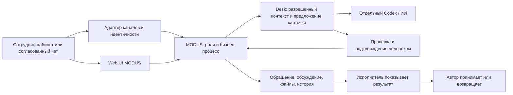

# Архитектура и техническая концепция

Диаграмма показывает полную концепцию. В автономном `npm start` работают Web UI, MODUS, хранилище и человеческое подтверждение; Adapter и внешнее ИИ-выполнение не подключаются.

## Компоненты и технологии

| Компонент | Ответственность и причина выбора |
|---|---|
| Node.js 24, стандартный HTTP | Локальный сервер без установки зависимостей для ядра; простой воспроизводимый запуск |
| Vanilla JS, HTML, CSS | Небольшой интерфейс для кабинета, карточек и обсуждений; не требуется отдельный сборочный сервис |
| `SuiteStore` / `PlatformStore` | Роли, маршруты, обращения, согласования, история, операции с проверкой редакций |
| JSON + отдельные файлы | Локальное хранение MVP; атомарная запись, резервный файл, проверка конфликтов и SHA-256 вложений |
| `CaseWorkspace` | Общая комната дела, реплики, план, редакции материалов и решения по конкретному файлу |
| PDF.js | Просмотр PDF в браузере, включая страницы и миниатюры; лицензия включена |
| Desk / Codex | Ограниченный контекст диалога, уточнение и структурированное предложение; внешняя зависимость |
| Adapter | Подключения каналов, проверенная привязка пользователя, передача и квитанции; отдельный компонент |

JSON-хранилище подходит для ограниченного локального пилота. Многопользовательское промышленное размещение, конкурентная запись из нескольких процессов, БД, эксплуатационный мониторинг и нагрузочные пределы требуют отдельной проработки. Этот пакет не подтверждает готовность такой инфраструктуры.

## Права и данные

Автор видит свои обращения; ответственный — назначенные ему; руководитель — обзор в пределах реализованной модели ролей. Администратор управляет компанией, ролями и правилами. Сервер проверяет доступ к обращению и оригиналу файла, а не только скрывает кнопку. Имена учебных сотрудников синтетические.

Пароли сохраняются как `scrypt`-хеши; сессии ограничены по времени, cookie имеет HttpOnly и SameSite=Strict; есть проверка происхождения изменяющих HTTP-запросов. Случайные пароли первого запуска находятся только в локальном `ACCESS.txt`. Для внедрения необходимы согласованные SSO/пользователи, HTTPS, хранение секретов, резервирование, сроки хранения и журнал администрирования. Эти меры не подтверждены одним локальным тестом.

ИИ не получает мастер-ключ Адаптера, не назначает произвольных адресатов и не обладает самостоятельным правом закрывать обращение. Его вывод проверяется по схеме и исходным цитатам. Разговор до регистрации не становится автоматически общим обсуждением. Чат не доказывает исполнение действия: результат и принятие фиксируют люди.

## Интеграции

| Система | Назначение и данные | Направление / способ | Что уточнить |
|---|---|---|---|
| Telegram / WhatsApp / MAX | Входящие сообщения, подтверждённый сотрудник, ответ и квитанция | Провайдер → Adapter → MODUS; ответ обратно в разрешённый канал | Корпоративный аккаунт, согласие, привязка, правила провайдера, доставка и вложения |
| Bitrix24 | Связать обращение с задачей/ответственным; получить идентификатор и состояние | Предусмотренный коннектор; реальные учётные данные и API проверяются отдельно | Портал, полномочия, поля, направление обновлений, владелец конфликтов |
| 1С УТ | Контекст процесса или идентификатор проекта при согласованной потребности | Планируемый ограниченный обмен; интеграция не реализована как принятая функция | Конфигурация, интерфейс, допустимые данные, доступ, частота |
| Корпоративная почта | Импорт выбранного письма с предпросмотром и отдельными подтверждениями | Через Adapter, выбранное подключение и проверку контекста | Учётная запись, полномочия, разрешённое содержание; вложения отдельно |

ТЗ не требует корпоративных интеграций в рамках хакатона. API-обработчик или тестовый транспорт не считаются подтверждением живого внешнего сценария.
