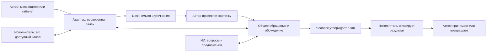

# PACTIQO MODUS R6 — компания, диалог и исполнение

Рабочее описание архитектуры от 12.11.2026. Оно не является свидетельством установки или живой приёмки: проверенные версии, сценарии и оставшиеся ограничения фиксируются отдельно в evidence/r6 и журнале проекта.

## Продукт

Сотрудник описывает проблему или улучшение обычным языком. Помощник уточняет обстоятельства и готовит карточку. Автор проверяет смысл и направление. После подтверждения появляется зарегистрированное обращение с ответственным, сроком и историей.

Далее работа продолжается в общем обсуждении этой карточки. Исполнитель выясняет детали с автором и помощником, предлагает план и фиксирует сделанное. Автор принимает результат или возвращает на доработку. Личный разговор до регистрации не раскрывается автоматически всем участникам.

Предложения сотрудников, клиентские лиды и запросы между отделами используют общие подключения и анализ, но сохраняют отдельные процессы и права. Наличие общего помощника не превращает предложение в приказ и не даёт ему полномочий менять коммерческие условия.

## Ответственность компонентов

| Компонент | Задача |
|---|---|
| MODUS / Desk | Компания, роли, обращения, CRM, общая карточка, проверка подтверждений, история и результат |
| Адаптер | Подключения, фактическая идентичность отправителя, сообщения и проверяемые квитанции |
| Codex CLI | Анализ разрешённого контекста под собственной учётной записью клиента |
| Внутренний Telegram-сервис | Работа с Bot API и защищённым локальным профилем; включается в состав комплекта, а не требует переноса нашей базы |

Интерфейс и сервер используют действующие права компании. Модель получает ограниченный контекст и возвращает структурированный совет. Она не получает мастер-ключ Адаптера, полномочие выбирать произвольного адресата или изменять жизненный цикл обращения.

## Компания и проверка личности

Штат импортируется CSV/JSON с предпросмотром. Имя, отдел, должность, руководитель, контакты, роль, предпочтительный канал и активность относятся к конкретной установке. Валидация проверяет дубли, иерархию, обязательные поля и наличие администратора. Ошибка пакета не должна приводить к частичному изменению компании.

Телефон или email из файла — контактная информация. Для привязки к боту отдельно нужен фактический сигнал из аккаунта, связанный с приглашением. Администратор проверяет кандидат и подтверждает его. Отключение сотрудника сохраняет историю и отзывает текущие права; уже отправленное внешнее сообщение отозвать задним числом нельзя.

Утверждённые должностные инструкции и регламенты служат источниками контекста. Владелец ответственности указывается явно. Текст документа не становится программной инструкцией и не назначает человеку дополнительные права. Синтетические примеры находятся в fixtures/company-demo.csv и company-demo-responsibility.md; они не описывают реальный штат «Модус Трейд».

## Улучшение работы

Помощник поддерживает цикл PDCA: установить факты и цель, согласовать небольшой план, выполнить, проверить результат, закрепить изменение либо доработать. Уважение к сотрудникам означает обсуждение процесса и препятствий, без психологических диагнозов и оценок личности по переписке. Сведения об экономии или сокращении потерь требуют измерения; ИИ не придумывает достигнутый эффект.

Методические основания: [Lean Enterprise Institute: Kaizen](https://www.lean.org/lexicon-terms/kaizen/), [PDCA](https://www.lean.org/lexicon-terms/pdca/), [Toyota Way](https://www.toyota-europe.com/about-us/toyota-vision-and-philosophy/the-toyota-way).

## Переписка и доступ к карточкам

Канал автора и канал исполнителя могут различаться. Сервер выбирает получателя по текущему участию в деле и подтверждённой привязке. Обсуждение хранится в одной карточке. На существующем личном owner-боте сохраняются специальные ограничения маршрута; корпоративный канал не должен наследовать право читать постороннюю переписку.

Ссылка содержит непрозрачный указатель. Для чтения требуется вход адресата и актуальное право на карточку. Пересылка ссылки другому сотруднику не передаёт доступ. Локальная демонстрация работает на компьютере; открытие с телефона требует отдельно настроенного HTTPS-адреса и проверенной сетевой доступности.

Быстрое подтверждение сохранения сообщения, результат анализа и квитанция провайдера — разные состояния. Канал с одним разрешённым ответом не должен расходовать его на промежуточное уведомление. Unknown означает необходимость сверить прежнюю операцию; новую отправку вместо неё автоматически создавать нельзя.

## Установка и состояние поставки

Программа и данные разделены. В комплект не включаются личные токены, база Telegram, cookies или авторизация Codex разработчика. Для клиентской установки нужны собственные учётные записи. Служебный Python получен как официальный Windows embeddable package; контрольная сумма и отдельная проверка чистого Telegram-сервиса записаны в evidence/r6/python-runtime-provenance.json. Это ещё не проверка всего установщика.

Проверка итоговой поставки должна включать чистую установку, старт без подключённого ИИ, повторный запуск, сохранение аккаунтов/обращений/вложений, полную резервную копию и восстановление в отдельную папку. Автозапуск задаётся явно. Личный Адаптер, к которому подключён демонстрационный MODUS, не принадлежит его процессу и не должен останавливаться вместе с ним.

Реальный Bitrix и сотрудники заказчика отложены до следующего этапа самим владельцем продукта. До подключения источник Bitrix обозначается как ненастроенный; тестовый API не выдаётся за корпоративный портал. Публичное размещение, регистрация новых аккаунтов и сдача организаторам не следуют автоматически из сборки приложения.
